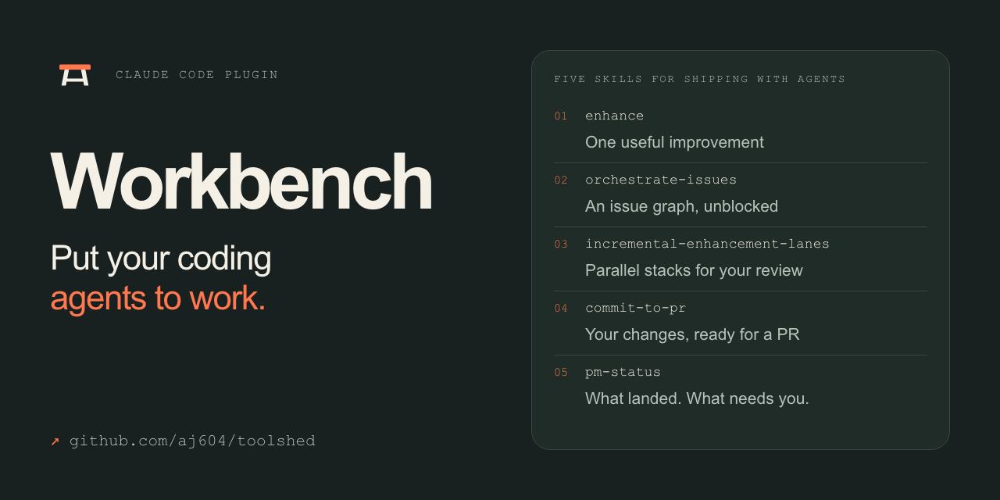

# Workbench

**Put your coding agents to work.**

Five [Claude Code](https://code.claude.com/docs/en/plugins) skills for turning
repo work into pull requests and keeping track of what shipped. Pick an
improvement, work through an issue graph, explore several areas in parallel,
or catch up after the agents finish.

## Install

In Claude Code:

```text
/plugin marketplace add aj604/toolshed
/plugin install workbench@toolshed
```

`toolshed` is the marketplace; `workbench` is the plugin. Run the skills from
the repo you want to work on.

Start with a catch-up:

```text
/workbench:pm-status
```

It reports what landed, what's in flight, what needs you, and what to do next.

## Pick the job

| You want to… | Skill | What you get |
|---|---|---|
| Find the next useful improvement | [`enhance`](plugins/workbench/skills/enhance/SKILL.md) | One improvement, chosen, built, verified, and opened as a PR |
| Implement a set of linked issues | [`orchestrate-issues`](plugins/workbench/skills/orchestrate-issues/SKILL.md) | Agents working on unblocked issues in isolated worktrees, with spec review and landing under an agreed run contract |
| Improve several areas at once | [`incremental-enhancement-lanes`](plugins/workbench/skills/incremental-enhancement-lanes/SKILL.md) | A stack of reviewed PRs per area, left open for you to accept or drop |
| Turn finished changes into a PR | [`commit-to-pr`](plugins/workbench/skills/commit-to-pr/SKILL.md) | A branch, commits, a push, and a new or updated PR |
| Catch up after agent work | [`pm-status`](plugins/workbench/skills/pm-status/SKILL.md) | A short report with blockers, work that hasn't shipped, and ranked next steps |

## Try it

Find something worth building:

```text
/workbench:enhance the CLI
```

Work through an existing issue graph:

```text
/workbench:orchestrate-issues
Work through the sub-issues of #42 with agents. Ask me to agree the run contract first.
```

Build options you can review independently:

```text
/workbench:incremental-enhancement-lanes
Improve CLI ergonomics, the test harness, and error handling in parallel for two rounds.
Leave the PR stacks open for my review.
```

Package the changes already in your working tree:

```text
/workbench:commit-to-pr
```

Catch up after a few days away:

```text
/workbench:pm-status 3d
```

## How much autonomy?

- **Enhance** chooses and builds one improvement, verifies it, and opens a PR.
- **Issue orchestration** agrees scope and merge authority before dispatching
  agents. It reviews work against the issues and follows the repo's merge gates.
- **Enhancement lanes** agree their areas and round count up front. Each round
  gets a spec review; the stacks stay open for human review.
- **Commit to PR** packages existing work. Validation belongs to the workflow
  that produced the changes and to CI.
- **PM status** gathers GitHub, git, and available session history to tell you
  where the work ended up.

## Requirements

Claude Code with plugin support, git, and the [GitHub CLI](https://cli.github.com/)
authenticated with access to the target repo (`gh auth login`). Use Python
3.10+ for the bundled helpers. Parallel workflows also need background agents
with worktree isolation. Agent work runs in your Claude Code sessions and uses
your model access.

[Usage and workflow details](plugins/workbench/README.md) ·
[Contributing](CONTRIBUTING.md) ·
[Launch copy](docs/marketing.md) ·
[Migration notes](docs/migration.md) ·
[MIT license](LICENSE)
