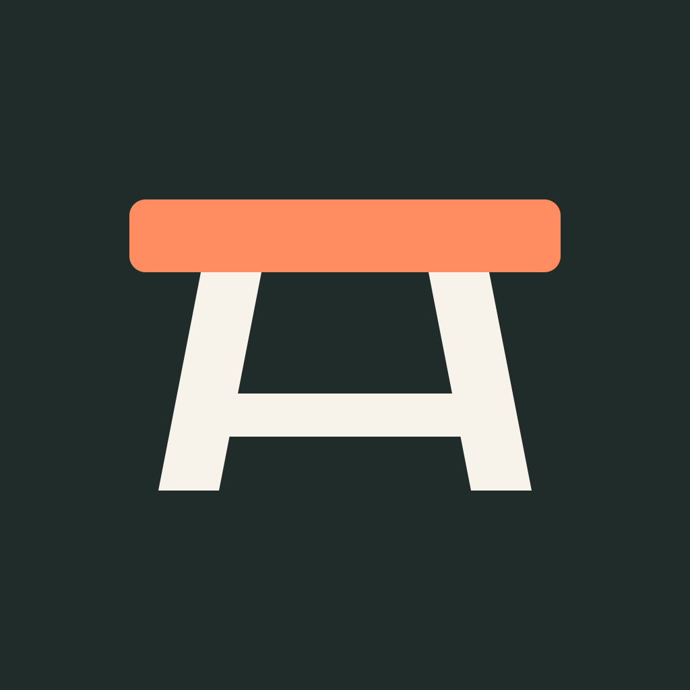

# Workbench for Claude Code

**Put your coding agents to work.**

Workbench bundles five skills for choosing useful work, coordinating agents,
opening pull requests, and catching up on what shipped.

## Install

```text
/plugin marketplace add aj604/toolshed
/plugin install workbench@toolshed
```

Run the skills inside the target repo. You'll need Claude Code with plugin
support, git, authenticated GitHub CLI (`gh auth login`), and Python 3.10+ for
the bundled helpers. The parallel workflows use background agents in isolated
git worktrees.

## Find and ship one improvement

```text
/workbench:enhance
```

Hand over the choice of what to build. Enhance reads the repo and its recent
direction, picks one useful improvement, implements it, verifies it, and opens
a PR. An optional area narrows the search:

```text
/workbench:enhance error handling
```

Use this when you want the agent's judgment about what comes next. With a
remote configured, the result is a PR; in a local-only repo, it commits the
work locally.

[Skill instructions](skills/enhance/SKILL.md)

## Work through an issue graph

```text
/workbench:orchestrate-issues
Implement the sub-issues of #42 with agents.
```

Start with existing GitHub issues and their native `blocked_by` dependencies.
You can scope the run to a parent issue, label, milestone, or explicit issue
list. The orchestrator agrees a run contract with you, then:

1. Dispatches an implementer for each ready issue in its own worktree.
2. Sends each PR to a separate spec reviewer.
3. Dispatches fixers for blocking findings within the agreed fix budget.
4. Lands eligible PRs under the agreed merge authority.
5. Reads the graph again as completed work unblocks the next issues.

The orchestrator coordinates; the agents implement. A lane needing a human
decision parks while other work continues. Merge authority, scope, splitting,
and fix budgets are settled before the first dispatch. Landing follows the
repo's merge gates.

[Skill instructions](skills/orchestrate-issues/SKILL.md)

## Explore several areas in parallel

```text
/workbench:incremental-enhancement-lanes
Improve the CLI, test harness, and error paths for two rounds each.
```

Agree a set of areas, the paths each lane owns, and a round count. A fresh
agent chooses one improvement per round; a spec reviewer checks the result.
Each round branches from the previous one, giving you a stack per lane:

```text
default branch
  ├── CLI:          round 1 → round 2
  ├── test harness: round 1 → round 2
  └── error paths:  round 1 → round 2
```

The stacks stay open for you. Accept a whole lane, take its first increment,
or drop it. A lane can end early if it runs out of valuable work or can't
clear review within its fix budget.

Use issue orchestration when the work is already specified. Use lanes when
you want agents to discover improvements inside bounded areas.

[Skill instructions](skills/incremental-enhancement-lanes/SKILL.md)

## Turn finished work into a PR

```text
/workbench:commit-to-pr
```

Turn uncommitted changes or unpushed commits into a new or updated PR. The
skill reads the diff, follows the repo's commit conventions, stages the
relevant files, creates a branch when needed, commits, and pushes.

Use `--draft` for a draft PR. This step packages the work; it does not run
tests, builds, or code review. It carries forward validation evidence supplied
by the workflow that produced the changes.

[Skill instructions](skills/commit-to-pr/SKILL.md)

## Come back to a clear status report

```text
/workbench:pm-status
```

Get four answers: **what landed, what's in flight, what needs you, and what
comes next**. PM status checks PRs, issues, CI, local worktrees and branches,
and available agent-session history. It distinguishes work merged into a
stack branch from work that reached the default branch.

By default it covers the time since your last check, or the last 48 hours on
the first run. Set a window when you need one:

```text
/workbench:pm-status 3d
```

The result is a short report with small text diagrams and ranked next steps.
It reports work needing cleanup or rescue so you can decide what to do.

[Skill instructions](skills/pm-status/SKILL.md)

## Under the hood

The skills are Markdown workflows with seven bundled agents and four Python
helpers. The helpers use the standard library; work happens through git, `gh`,
and Claude Code's agent tools.

| Component | Role |
|---|---|
| `orchestrate-issues/scripts/frontier.py` | Reads issue dependencies and classifies ready, in-flight, blocked, and completed work |
| `orchestrate-issues/scripts/prune_worktrees.py` | Removes subagent worktrees whose lanes merged or closed, once they hold nothing GitHub lacks |
| `incremental-enhancement-lanes/scripts/lanes.py` | Reconstructs branches, PRs, and stack bases for resume and verification |
| `pm-status/scripts/gather.py` | Collects git, GitHub, and local-session facts and compares issue frontiers between runs |
| `pm-status/scripts/check_report.py` | Checks report structure and open-PR coverage before presenting it |
| [`implementer`](agents/implementer.md) | Builds one issue and opens a draft PR |
| [`spec-reviewer`](agents/spec-reviewer.md) | Reviews a PR against its issue |
| [`fixer`](agents/fixer.md) | Addresses blocking review findings |
| [`premise-checker`](agents/premise-checker.md) | Checks an issue's claims against the code and assesses its size |
| [`verifier`](agents/verifier.md) | Rechecks fixes that only touched tests |
| [`rebaser`](agents/rebaser.md) | Updates a PR branch from a moved base |
| [`ci-diagnostic`](agents/ci-diagnostic.md) | Distinguishes regressions, existing failures, and broken gates |

[Marketplace and quick start](../../README.md) ·
[Contributing](../../CONTRIBUTING.md) ·
[MIT license](../../LICENSE)
